# EC19-01: Sporekart System Inventory & Dependency Map

**Document Version:** 1.0.0  
**Audit Phase:** EC-19 Cross-Module Integration & End-to-End Regression Testing  
**Auditor:** Senior QA Architect, Staff Software Engineer, E-commerce Integration Tester, Database Integrity Auditor  
**Date:** October 27, 2026  
**Target Repository:** `sporekart-final`  
**Environment:** Windows | Node.js v20+ / Vite | Java 21 / Spring Boot 3.3.3 | PostgreSQL (Supabase Cloud Pooler) | Supabase Object Storage  

---

## 1. System Technology Stack & Version Matrix

| Tier | Component / Technology | Exact Version in Repo | Configuration / Runtime Location |
| :--- | :--- | :--- | :--- |
| **Frontend Framework** | React | `18.3.1` | [`frontend/package.json`](file:///f:/sporekart-v1/sporekart-final/frontend/package.json) |
| **Frontend Tooling** | Vite | `5.4.1` | [`frontend/vite.config.js`](file:///f:/sporekart-v1/sporekart-final/frontend/vite.config.js) |
| **Frontend Routing** | React Router DOM | `6.26.1` | [`frontend/src/App.jsx`](file:///f:/sporekart-v1/sporekart-final/frontend/src/App.jsx) (v7 future flags enabled) |
| **Frontend SEO** | react-helmet-async | `2.0.1` | [`frontend/src/components/common/SeoHead.jsx`](file:///f:/sporekart-v1/sporekart-final/frontend/src/components/common/SeoHead.jsx) |
| **Frontend Styling** | TailwindCSS + PostCSS | `3.4.10` / `8.4.41` | [`frontend/tailwind.config.js`](file:///f:/sporekart-v1/sporekart-final/frontend/tailwind.config.js) |
| **Frontend HTTP Client**| Axios | `1.7.4` | [`frontend/src/api.js`](file:///f:/sporekart-v1/sporekart-final/frontend/src/api.js) |
| **Frontend Storage SDK**| @supabase/supabase-js | `2.117.3` | Used for client-side direct asset retrieval |
| **Frontend Testing** | Vitest + Testing Library | `1.6.1` / `16.3.3` | 25 test suites, 140 specifications |
| **Backend Framework** | Spring Boot | `3.3.3` | [`backend/pom.xml`](file:///f:/sporekart-v1/sporekart-final/backend/pom.xml) |
| **Backend Runtime** | Java OpenJDK | `21` | Maven Compiler Plugin configuration |
| **Security & Auth** | Spring Security + JJWT | `6.3.3` / `0.12.6` | Stateless JWT Bearer Auth Filter |
| **Database ORM** | Spring Data JPA / Hibernate | `6.5.2.Final` | PostgreSQL dialect, batch fetch size 50 |
| **Schema Migrations** | Flyway | `10.10.0` | `43` SQL migration scripts in `classpath:db/migration` |
| **Payment Gateway** | Razorpay Java SDK | `1.4.6` | Standard REST checkout + Webhooks |
| **Database Engine** | PostgreSQL (Supabase Cloud) | `15.x` | `aws-0-ap-northeast-1.pooler.supabase.com:6543/postgres` |
| **Object Storage** | Supabase Storage Bucket | `sporetest-bucket` | Presigned URLs + media asset tracking |
| **Mailing Service** | Spring Mail (JavaMail) | Spring Boot Starter | Real SMTP / Google Workspace Relay |
| **Log & Architecture** | SLF4J + ArchUnit | `1.3.0` | Architectural rule governance |

---

## 2. Architectural Boundaries & Cross-Module Dependency Map

The Sporekart platform is structured as a **Modular Monolith** with clear bounded contexts. The diagram below illustrates data exchange and transactional dependencies between modules:

```mermaid
graph TD
    Client["Browser Frontend (React + Vite)"] --> Gateway["REST API Layer (/api/v1)"]
    
    subgraph IdentityContext ["Identity & Access Context"]
        AuthCtrl["AuthController"] --> AuthService["AuthService"]
        AuthService --> UserRepo[("User & Identity Tables")]
    end

    subgraph CatalogContext ["Catalog & Inventory Context"]
        CatCtrl["CatalogController"] --> CatService["CatalogApplicationService"]
        InvService["InventoryService"] --> InvRepo[("Inventory & Audit Tables")]
        CatService --> PriceService["PricingService"]
    end

    subgraph CartOrderContext ["Cart & Order Processing Context"]
        CartCtrl["CartController"] --> CartService["CartService"]
        OrderCtrl["OrderController"] --> OrderService["OrderService"]
        OrderService --> InvService
        OrderService --> PriceService
        OrderService --> PromoService["PromotionService"]
        OrderService --> OrderRepo[("Orders & Items Tables")]
    end

    subgraph PaymentContext ["Payment & Financial Context"]
        PayCtrl["RazorpayCheckoutController"] --> RazorpayGateway["RazorpayPaymentGateway"]
        PayService["PaymentService"] --> PayRepo[("Payment & Refund Tables")]
        RazorpayGateway -.-> ExternalRazorpay["Razorpay API (Test Mode)"]
    end

    subgraph ShippingContext ["Shipping & Fulfillment Context"]
        ShipCtrl["ShippingController"] --> ShipService["ShippingService"]
        ShipService --> ShipAdapter["ShiprocketAdapter"]
        ShipAdapter -.-> ExternalShiprocket["Shiprocket (Mock / Sandbox)"]
        ShipService --> ShipRepo[("Shipment Tables")]
    end

    subgraph TrainingContext ["Agritech Training Context"]
        TrainCtrl["TrainingController"] --> TrainService["TrainingService"]
        TrainService --> TrainRepo[("Courses, Batches & Enrollments")]
        TrainService --> PromoService
    end

    subgraph SupportNotificationContext ["Support & Communications Context"]
        SupportCtrl["SupportController"] --> SupportService["SupportApplicationService"]
        NotifService["NotificationEventService"] --> EmailWorker["NotificationWorker (SMTP)"]
        NotifService --> InAppRepo[("Notification Events Table")]
    end

    %% Key Inter-Module Data Flows
    Gateway --> AuthCtrl
    Gateway --> CatCtrl
    Gateway --> CartCtrl
    Gateway --> OrderCtrl
    Gateway --> PayCtrl
    Gateway --> ShipCtrl
    Gateway --> TrainCtrl
    Gateway --> SupportCtrl

    OrderService -- "Reserve Stock" --> InvService
    OrderService -- "Confirm Payment" --> PayService
    PayCtrl -- "Payment Success Event" --> OrderService
    PayCtrl -- "Payment Success Event" --> TrainService
    OrderService -- "Create Shipment" --> ShipService
    OrderService -- "Emit Business Event" --> NotifService
    TrainService -- "Emit Enrollment Event" --> NotifService
    SupportService -- "Verify Order Ownership" --> OrderRepo
```

---

## 3. Database Schema Reconnaissance (Supabase PostgreSQL)

The live production-parity PostgreSQL database contains **59 public tables** across all functional domains:

| Domain | Table Name | Existing Row Count | Description & Constraints |
| :--- | :--- | :--- | :--- |
| **Orders** | `orders` | **640** | Primary order record. FK to `users` (nullable for guest checkout), unique order number, idempotency key. |
| **Orders** | `order_items` | **652** | Line items. FK to `orders`, FK to `product_variants`. Includes captured unit price, GST, and discount snapshots. |
| **Orders** | `order_events` | **1,312** | Immutable audit log of order status transitions (`PENDING_PAYMENT` -> `PAID` -> `PROCESSING` -> etc.). |
| **Payments** | `payments` | **274** | Authoritative payment transaction records. FK to `orders` (nullable for training), `razorpay_payment_id`, status. |
| **Payments** | `payment_events` | **561** | Event ledger capturing verification attempts, signatures, webhooks, and gateway callbacks. |
| **Refunds** | `refunds` | **78** | Explicit refund tracking table (`V40`). FK to `payments`, `razorpay_refund_id`, status, amount. |
| **Catalog** | `products` | **145** | Product entities with SEO metadata, publishing status, categories. |
| **Catalog** | `product_variants`| **210** | Specific SKU/weight variants (150g, 250g, etc.) with independent pricing, dimensions, and weight. |
| **Catalog** | `product_information`| **122** | Extended agronomy details, composition, storage instructions, and FSSAI compliance metadata. |
| **Inventory** | `inventory_records`| **164** | Variant stock balances (`available_quantity`, `reserved_quantity`). Non-negative check constraint. |
| **Inventory** | `inventory_audit_events`| **1,326** | Immutable stock ledger recording allocations, deductions, restocks, and returns with reason strings. |
| **Cart** | `carts` | **1,057** | Active and converted shopping carts. Unique active cart per user/session (`V37`). |
| **Cart** | `cart_items` | **256** | Line items in active carts. FK to `product_variants`. |
| **Shipping** | `shipments` | **40** | Courier shipments linked 1:1 with orders (`V36`). AWB tracking code, carrier name, status. |
| **Shipping** | `shipment_trackings`| **159** | Event checkpoint trail from carrier updates and simulation webhooks. |
| **Training** | `courses` | **31** | Masterclasses and cultivation training courses with duration and fee structures. |
| **Training** | `batches` | **38** | Scheduled training batches with start date, mode (ONLINE/OFFLINE), max capacity, enrolled count. |
| **Training** | `enrollments` | **92** | Trainee registrations. FK to `users` and `batches`. Payment reference and attendance state. |
| **Support** | `support_tickets` | **95** | Customer helpdesk tickets. Category, priority, status, CSAT rating, FK to `users` and `orders`. |
| **Support** | `ticket_messages` | **272** | Threaded conversation between customer and admin agents. |
| **Communications**| `notification_events`| **9,753**| System-wide notification dispatch queue. Deduplication keys, delivery status, in-app read flags. |
| **Identity** | `users` | **552** | Primary user accounts. Email, role (`ROLE_CUSTOMER`, `ROLE_ADMIN`), status. |
| **Identity** | `customer_identities`| **801**| OAuth identity links (Google Sub, Provider). Prevents duplicate user accounts. |
| **Identity** | `customer_addresses` | **186** | Verified shipping addresses with primary phone and alternate delivery contact numbers. |
| **Media** | `media_assets` | **18** | Uploaded image records in Supabase bucket, partitioned storage paths, MIME whitelisting. |
| **CMS** | `blog_posts` | **11** | Published educational articles, SEO canonical URLs (`https://sporekart.in/blog/...`), tags. |
| **Promotions**| `promotions` | **13** | Percentage and flat discount codes for customer cart and trainee batches. |
| **Audit** | `admin_audit_logs`| **640** | Administrative change tracking log across all admin dashboard modules. |
| **Analytics** | `analytics_events`| **3,370**| Behavioral analytics event stream (Product views, checkout started, funnel conversions). |
| **Archived** | `wallets` | **47** | Formally retired in `V41`. Preserved solely as historical financial audit records. |

---

## 4. Integration Inventory & Mock Configuration

| Integration | Provider | Operational Mode | Implementation Detail & Rule Adherence |
| :--- | :--- | :--- | :--- |
| **Payment Gateway** | Razorpay | **Test Mode / Configured SDK** | Key ID `rzp_test_Tqs0MmdXUl8FRk`. HMAC-SHA256 signature verification enabled. Server-to-server payment status verification active. Rule C.2 & C.7 compliant. |
| **Courier / Logistics**| Shiprocket | **Mock Mode (Default)** | `sporekart.shiprocket.use-real-shiprocket=false`. Simulates AWB assignment, tracking updates, and webhook ingestion safely without courier dispatch. Rule C.8 compliant. |
| **User Authentication**| Google OAuth 2.0 | **Active (Google Sub / JWT)** | Client-side Google Sign-In with backend token verification via `/auth/oauth/google`. Email/phone OTP permanently retired with HTTP 410. Rule C.3 & C.4 compliant. |
| **Email Service** | Spring Mail (SMTP)| **Active Relay** | Configured with TLS 587. Emits order confirmations, invoices, and passwordless alerts. Rule C.5 compliant. |
| **In-App Alerts** | Polling REST Queue | **Active Database Queue** | Dedicated endpoints `/notifications` and `/admin/notifications/in-app`. Real-time unread badges. |
| **Object Storage** | Supabase Storage | **Active Cloud Bucket** | Direct presigned upload flow to `sporetest-bucket`. MIME verification and 25MB limits. |
| **Customer Wallet** | Internal Ledger | **RETIRED (`V41`)** | All wallet topups, deductions, and wallet-based refunds disabled. Preserved as read-only audit log. Rule C.1 compliant. |

---

## 5. Baseline Status of Prior EC Testing Phases (EC-01 through EC-18)

| Phase | Scope | Baseline Status | Artifact Location / Verification Note |
| :--- | :--- | :--- | :--- |
| **EC-01 to EC-12** | Catalog, Cart, Order, Basic Payment, Shipping | **Completed & Audited** | Documented in `audit-reports/sporekart-e2e-audit-2026-10-19/`. Verified via existing unit/integration suites. |
| **EC-13 to EC-16** | PRR, Razorpay Hardening, Wallet Retirement, SMS Removal | **Completed & Verified** | Confirmed by Flyway migrations `V40`, `V41` and Git commit `7fd470a`. |
| **EC-17** | Admin Training, CMS, Support & Analytics Audit | **100% Passed (94/94)** | Verified via [`ec17_audit_master_report.md`](file:///C:/Users/admin/.gemini/antigravity-ide/brain/60c5b624-088d-4b28-a968-d3093d125bac/ec17_audit_master_report.md). 140 frontend vitest specs passed. |
| **EC-18** | Media, SEO, Canonical URLs & Content Infrastructure | **100% Passed (97/97)** | Verified via [`ec18_audit_master_report.md`](file:///C:/Users/admin/.gemini/antigravity-ide/brain/60c5b624-088d-4b28-a968-d3093d125bac/ec18_audit_master_report.md). Domain harmonized to `https://sporekart.in`, 404 insulation fixed, XML sitemap caching active. |

---

## 6. Identified Cross-Module Risk Hotspots for EC-19

Based on code analysis and entity mapping, the following integration points represent primary risk areas to rigorously test:
1. **Cart-to-Order Conversion & Multi-Variant Stock Lock:** Ensuring purchasing Variant A (e.g. 150g) does NOT decrement stock of Variant B (e.g. 250g) of the same product, and stock remains locked until payment completion or release.
2. **Payment Callback Race Conditions:** Browser callback vs Razorpay Webhook delivery. Either event must transition order to `PAID` without duplicate status events, duplicate invoices, or double shipping triggers.
3. **Cancellation & Inventory Recovery Lifecycle:** An order cancelled while `PENDING_PAYMENT` releases reserved stock immediately; a paid order triggers a tracked Razorpay refund (`REFUND_PENDING` -> `REFUNDED`) and releases stock without double-crediting.
4. **Courier Delivery Status vs Order Terminal State:** Courier marking `DELIVERED` must trigger invoice generation and review invitations, but must NEVER be allowed to overwrite an already `CANCELLED` or `REFUNDED` order.
5. **Training Batch Concurrency:** Simultaneous registrations on the last remaining slot of a batch must reject overbooking via database row lock.
6. **Authorization Boundaries & IDOR Prevention:** Ensuring customer A cannot fetch or cancel customer B's order, link customer B's order to a support ticket, or access `/admin/**` endpoints.
