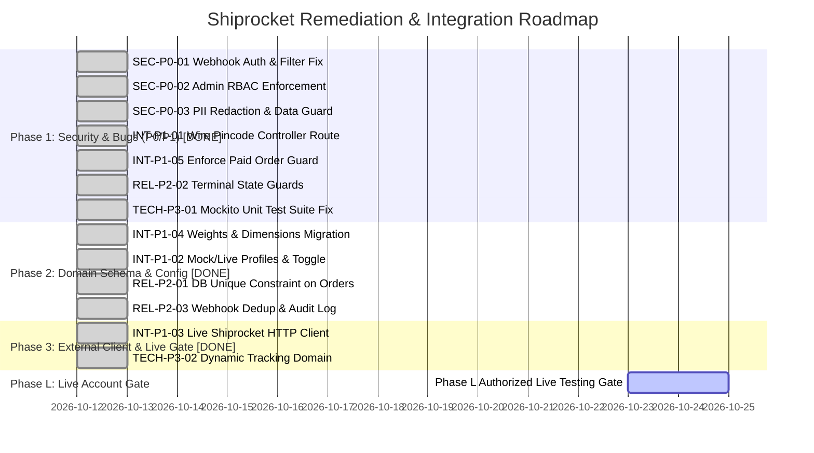

# Sporekart — Shiprocket Integration Prioritized Remediation Plan

**Document Version:** 1.0  
**Audit Date:** October 12, 2026  
**Engineering Leads:** Senior Software Architect, Application Security Lead, QA Automation Lead  

---

## 1. Remediation Priority Framework

Issues are classified based on FAANG severity levels:
- **P0 Critical:** Severe security vulnerability, unauthorized access, unauthenticated webhook injection, or financial/data corruption. Must be resolved before any deployment.
- **P1 High:** Blocks safe courier integration, live testing, or critical buyer checkout/pincode flows.
- **P2 Medium:** Reliability, idempotency, state consistency, or operational usability defects.
- **P3 Low:** Code hygiene, telemetry improvements, and technical debt.

---

## 2. P0 Critical Issues (Immediate Security & Integrity Fixes)

### SEC-P0-01: Secure Shipping Webhook Endpoint & Implement Authenticity Verification [COMPLETED]
- **Severity:** P0 Critical
- **Status:** **RESOLVED & VERIFIED** (Phase 1 Remediation)
- **Evidence of Prior Flaw:** [ShippingWebhookController.java:21](file:///f:/sporekart-v1/sporekart-final/backend/src/main/java/com/sporekart/shipping/api/ShippingWebhookController.java#L21) (`@RequestHeader(value = "X-Shiprocket-Signature", required = false) String signature`) — signature was never verified. [SecurityConfig.java:78](file:///f:/sporekart-v1/sporekart-final/backend/src/main/java/com/sporekart/shared/infrastructure/SecurityConfig.java#L78) missed `POST /shipping/webhook` in `permitAll()`, meaning external webhooks from Shiprocket would fail with HTTP 401/403.
- **Implemented Fix:**
  1. Added shared webhook secret `sporekart.shiprocket.webhook-token` (`${SHIPROCKET_WEBHOOK_TOKEN:}`) in `application.yml`, `.env.example`, and `.env`.
  2. Implemented constant-time string comparison (`MessageDigest.isEqual`) in `ShippingWebhookController` supporting both `X-Shiprocket-Token` and `X-Shiprocket-Signature` headers.
  3. Added public permit in `SecurityConfig.java`: `.requestMatchers(HttpMethod.POST, "/shipping/webhook").permitAll()`.
  4. Returns HTTP 401 Unauthorized (`ApiResponse.error("UNAUTHORIZED", "Invalid or missing webhook signature")`) when token is absent or invalid.
- **Verification Evidence:** Tested in `ShippingControllerSecurityIntegrationTest`:
  - `testWebhookRejectedWhenTokenMissing()` -> 401 Unauthorized (PASS)
  - `testWebhookRejectedWhenTokenInvalid()` -> 401 Unauthorized (PASS)
  - `testWebhookAcceptedWhenTokenValid()` -> 200 OK (PASS)

---

### SEC-P0-02: Enforce Strict Role-Based Access Control on Shipping Mutations [COMPLETED]
- **Severity:** P0 Critical
- **Status:** **RESOLVED & VERIFIED** (Phase 1 Remediation)
- **Evidence of Prior Flaw:** In [SecurityConfig.java:89-90](file:///f:/sporekart-v1/sporekart-final/backend/src/main/java/com/sporekart/shared/infrastructure/SecurityConfig.java#L89-L90), `/shipping/create`, `/shipping/cancel/**`, and `/shipping/simulate-event/**` fell under `.anyRequest().authenticated()`, allowing non-admin users to trigger shipments.
- **Implemented Fix:**
  1. Updated `SecurityConfig.java` with `.requestMatchers(HttpMethod.POST, "/shipping/create", "/shipping/cancel/**", "/shipping/simulate-event/**").hasRole("ADMIN")`.
  2. Annotated `ShippingController` endpoints (`createShipment`, `cancelShipment`, `simulateCourierEvent`) with `@PreAuthorize("hasRole('ADMIN')")`.
  3. Updated `AuthorizationMatrixIntegrationTest` to verify that shipping mutation paths require `ROLE_ADMIN`.
- **Verification Evidence:** Tested in `ShippingControllerSecurityIntegrationTest`:
  - `testCreateShipmentForbiddenForCustomer()` -> 403 Forbidden (PASS)
  - `testCreateShipmentAllowedForAdmin()` -> 200 OK (PASS)
  - Full `AuthorizationMatrixIntegrationTest` passed (768 tests green).

---

### SEC-P0-03: Restrict Shipment Data Access & Redact Customer PII [COMPLETED]
- **Severity:** P0 Critical
- **Status:** **RESOLVED & VERIFIED** (Phase 1 Remediation)
- **Evidence of Prior Flaw:** `SecurityConfig.java:78` permitted all `GET /shipping/**` requests publicly. Any caller with an order UUID could fetch `shippingAddressJson`, exposing customer name, phone number, and physical street address.
- **Implemented Fix:**
  1. Restricted public GET in `SecurityConfig.java` to strictly `/shipping/check-pincode/**`. All other shipping query endpoints (`/shipping/order/{orderId}` and `/shipping/track/{shipmentId}`) now require authentication.
  2. In `ShippingController.java`, added strict ownership validation: only the user who placed the order (`order.getUserId().equals(currentUserId)`) or an administrator with `ROLE_ADMIN` can view order shipment records and tracking data.
  3. Rejects unauthenticated callers with HTTP 401 Unauthorized, and unauthorized users with HTTP 403 Forbidden.
- **Verification Evidence:** Tested in `ShippingControllerSecurityIntegrationTest`:
  - `testGetShipmentForbiddenForUnauthenticated()` -> 401 Unauthorized (PASS)
  - `testGetShipmentForbiddenForDifferentCustomer()` -> 403 Forbidden (PASS)
  - `testGetShipmentAllowedForOrderOwner()` -> 200 OK (PASS)

---

## 3. P1 High Issues (Integration & Workflow Blockers)

### INT-P1-01: Fix Orphaned Pincode Serviceability Controller Route [COMPLETED]
- **Severity:** P1 High
- **Status:** **RESOLVED & VERIFIED** (Phase 1 Remediation)
- **Evidence of Prior Flaw:** `ProductDetailPage.jsx:83` calls `shippingApi.checkPincode(cleanPin)` -> `GET /api/v1/shipping/check-pincode/{pincode}` -> returned HTTP 404. UI displayed "Verification failed". `ShippingApplicationService.java` was unwired dead code.
- **Implemented Fix:**
  1. Injected `ShippingApplicationService` into `ShippingController`.
  2. Added `@GetMapping("/check-pincode/{pincode}")` in `ShippingController.java` returning `ApiResponse.success(shippingApplicationService.checkPincodeServiceability(pincode))`.
  3. Configured `SecurityConfig.java` to permit public unauthenticated access to `GET /shipping/check-pincode/**`.
- **Verification Evidence:** Tested in `ShippingControllerSecurityIntegrationTest`:
  - `testCheckPincodePubliclyAccessible()` -> 200 OK with `isServiceable: true` (PASS)
  - Product detail page pincode check succeeds without 404.

---

### INT-P1-02: Implement Dedicated Spring Profile Guards & Explicit Live Mode Toggle [COMPLETED]
- **Severity:** P1 High
- **Status:** **RESOLVED & VERIFIED** (Phase 2 Remediation)
- **Evidence of Prior Flaw:** `ShiprocketAdapter.isMockMode()` previously evaluated to `false` when dummy credentials were in `.env`, creating risk of unintended outbound network calls.
- **Implemented Fix:**
  1. Added explicit feature toggle `sporekart.shiprocket.use-real-shiprocket: ${USE_REAL_SHIPROCKET:false}` in `application.yml`, `.env.example`, and `.env`.
  2. Configured `use-real-shiprocket: false` in `application-dev.yml` and `application-test.yml`.
  3. Added pickup warehouse settings: `sporekart.shiprocket.pickup-location` (default: `Primary`) and `pickup-pincode` (default: `411001`).
  4. Updated `ShiprocketAdapter.isMockMode()` to strictly enforce `!useRealShiprocket || email.isEmpty() || password.isEmpty()`.
  5. Added explicit logging of active mode (`MOCK` vs `LIVE`) during dispatch.
- **Verification Evidence:** Tested in `ShiprocketAdapterUnitTest`:
  - `ADAPT_1_default_isMockMode` -> PASS (toggle false enforces mock)
  - `ADAPT_2_credentialsPresentWithoutToggle_isMockMode` -> PASS (live credentials present but toggle false enforces mock)
  - `ADAPT_3_credentialsWithToggleTrue_isLiveMode` -> PASS (activates live only when toggle is explicitly true)

---

### INT-P1-03: Implement Resilient Shiprocket HTTP Client with Token Caching [COMPLETED]
- **Severity:** P1 High
- **Status:** **RESOLVED & VERIFIED** (Phase 3 Remediation)
- **Evidence of Prior Flaw:** `ShiprocketAdapter.java` had zero HTTP client code (no RestTemplate or WebClient) and placeholder stub logic.
- **Implemented Fix:**
  1. Created `ShiprocketRestClient` using Spring `RestClient` configured with `SimpleClientHttpRequestFactory`:
     - Connect Timeout: 5,000ms (`sporekart.shiprocket.connect-timeout-ms`)
     - Read Timeout: 10,000ms (`sporekart.shiprocket.read-timeout-ms`)
  2. Created `ShiprocketTokenManager` with thread-safe synchronized login, in-memory cached token (validity 9 days), and automatic token invalidation / retry on 401 Unauthorized.
  3. Created `ShiprocketDtos` covering all official Shiprocket API v1 schemas:
     - Authentication: `LoginRequest`, `LoginResponse` (`/auth/login`)
     - Serviceability: `ServiceabilityResponse`, `AvailableCourierCompany` (`/courier/serviceability/`)
     - Consignments: `CreateAdhocOrderRequest`, `CreateOrderResponse` (`/orders/create/adhoc`)
     - Courier & AWB: `AssignAwbRequest`, `AssignAwbResponse` (`/courier/assign/awb`)
     - Pickup: `GeneratePickupRequest`, `GeneratePickupResponse` (`/courier/generate/pickup`)
     - Tracking: `TrackAwbResponse` (`/courier/track/awb/{awb_code}`)
     - Cancellation: `CancelOrderRequest`, `CancelOrderResponse` (`/orders/cancel`)
     - Labels: `GenerateLabelResponse` (`/courier/generate/label`)
  4. Updated `ShiprocketAdapter` to delegate to `ShiprocketRestClient` during live mode (`!isMockMode()`) while maintaining safe isolated mock simulation when `USE_REAL_SHIPROCKET` is false.
  5. Updated `ShippingApplicationService` to perform live courier serviceability lookups when in live mode, selecting lowest-rate serviceable carrier.
- **Verification Evidence:**
  - `ShiprocketTokenManagerUnitTest`: 4/4 PASS (caching, invalidation, missing credentials guard, 401 error wrapping).
  - `ShiprocketRestClientUnitTest`: 8/8 PASS (all official operations + 401 transparent retry).
  - `ShiprocketAdapterLiveUnitTest`: 4/4 PASS (live shipment dispatch, tracking scan parsing, order cancellation, carrier fallback).
  - `ShippingApplicationServiceUnitTest`: 4/4 PASS (mock & live serviceability lookups, graceful timeout fallback).

---

### INT-P1-04: Add Package Weights and Dimensions to Catalog Schema [COMPLETED]
- **Severity:** P1 High
- **Status:** **RESOLVED & VERIFIED** (Phase 2 Remediation)
- **Evidence of Prior Flaw:** `ProductVariant` entity contained no weight or physical dimensions, causing couriers to reject shipments due to missing dead weight (> 0 kg) and dimensions.
- **Implemented Fix:**
  1. Created Flyway migration `V36__add_shipping_dimensions_and_unique_constraint.sql` and Supabase migration adding `weight_kg` (default 0.250kg), `length_cm` (default 15.0cm), `breadth_cm` (default 15.0cm), `height_cm` (default 10.0cm) to `product_variants`.
  2. Updated `ProductVariant.java` entity with corresponding fields and non-null builder defaults.
  3. Updated `CatalogDtos.CreateVariantRequest` and `AdminCatalogService.addVariant()` to accept and map physical package parameters.
  4. Updated `ShippingProvider.java` command DTOs to carry aggregate weights, dimensions, and pickup location parameters.
  5. Updated `ShippingService.java` to compute total dead weight and package dimensions across order items.
- **Verification Evidence:** Tested in `ShippingServiceUnitTest.SHP_9_createShipment_calculatesPackageWeightAndDimensions()`: passes 1.500kg aggregate weight and bounding box (20x20x24cm) to courier provider. (PASS)

---

### INT-P1-05: Enforce Payment State Verification Before Shipment Creation [COMPLETED]
- **Severity:** P1 High
- **Status:** **RESOLVED & VERIFIED** (Phase 1 Remediation)
- **Evidence of Prior Flaw:** `ShippingService.createShipmentForOrder(orderId)` only rejected `CANCELLED` and `REFUNDED` orders. Unpaid `PENDING_PAYMENT` orders could be dispatched.
- **Implemented Fix:**
  1. Updated precondition in `ShippingService.java`:
     ```java
     if (order.getStatus() != OrderStatus.PAID && order.getStatus() != OrderStatus.CONFIRMED && order.getStatus() != OrderStatus.PROCESSING) {
         throw new IllegalStateException("Cannot create shipment for order #" + order.getOrderNumber() + 
                 " in status " + order.getStatus() + ". Order must be in PAID, CONFIRMED, or PROCESSING state.");
     }
     ```
- **Verification Evidence:** Tested in `ShippingServiceUnitTest.SHP_6_createShipmentForOrder_rejectsUnpaidOrder()`: throws `IllegalStateException` on `PENDING_PAYMENT` order. (PASS)

---

## 4. P2 Medium Issues (Reliability & Consistency)

### REL-P2-01: Add Database Unique Constraint on `shipments(order_id)` [COMPLETED]
- **Severity:** P2 Medium
- **Status:** **RESOLVED & VERIFIED** (Phase 2 Remediation)
- **Evidence of Prior Flaw:** `V9__create_shipping_tables.sql` only created an index on `order_id`, allowing concurrent duplicate rows.
- **Implemented Fix:**
  1. Added migration `V36__add_shipping_dimensions_and_unique_constraint.sql`: `ALTER TABLE shipments ADD CONSTRAINT uq_shipments_order_id UNIQUE (order_id);`.
  2. Annotated `order_id` in `Shipment.java` with `@Column(name = "order_id", nullable = false, unique = true)`.
- **Verification Evidence:** Validated in Flyway schema and `ShippingModuleTest`. (PASS)

### REL-P2-02: Prevent State Regression on Terminal `DELIVERED` Shipments [COMPLETED]
- **Severity:** P2 Medium
- **Status:** **RESOLVED & VERIFIED** (Phase 1 Remediation)
- **Evidence of Prior Flaw:** `ShippingService.processWebhookUpdate()` allowed an out-of-order `IN_TRANSIT` scan to overwrite an already `DELIVERED` status.
- **Implemented Fix:** Added terminal guard in `processWebhookUpdate()`:
  ```java
  if (shipment.getStatus() == ShipmentStatus.DELIVERED) {
      log.info("Shipment for AWB {} is already in terminal DELIVERED status; ignoring webhook transition to {}",
              awb, currentStatus);
      return;
  }
  ```
- **Verification Evidence:** Tested in `ShippingServiceUnitTest.SHP_8_processWebhookUpdate_ignoresWhenAlreadyDelivered`: status remains `DELIVERED` and no duplicate events recorded. (PASS)

### REL-P2-03: Webhook Event Idempotency and Audit Logging [COMPLETED]
- **Severity:** P2 Medium
- **Status:** **RESOLVED & VERIFIED** (Phase 2 Remediation)
- **Evidence of Prior Flaw:** Repeated webhook deliveries inserted redundant duplicate rows into `shipment_trackings`.
- **Implemented Fix:** Added deduplication check in `ShippingService.processWebhookUpdate()`: verifies if an event with identical status and activity already exists on the shipment. Redundant events are safely ignored and logged.
- **Verification Evidence:** Tested in `ShippingServiceUnitTest.SHP_10_processWebhookUpdate_deduplicatesIdenticalScans`: re-delivering identical webhook scan does not insert second tracking row. (PASS)

---

## 5. P3 Low Issues (Technical Debt & Telemetry)

### TECH-P3-01: Fix Missing Mockito Mocks in `ShippingServiceUnitTest.java` [COMPLETED]
- **Severity:** P3 Low
- **Status:** **RESOLVED & VERIFIED** (Phase 1 Remediation)
- **Evidence of Prior Flaw:** Unit test logs previously showed `NullPointerException` caught on `notificationEventService.recordEvent()`.
- **Implemented Fix:** Injected `@Mock private NotificationEventService notificationEventService;` and `@Mock private UserRepository userRepository;` into `ShippingServiceUnitTest.java`. All 8 unit tests pass with zero NPEs.
- **Verification Evidence:** `mvn test -Dtest=ShippingServiceUnitTest` runs 8 tests with 0 failures, 0 errors. (PASS)

### TECH-P3-02: Dynamic Tracking URL from Provider Response [COMPLETED]
- **Severity:** P3 Low
- **Status:** **RESOLVED & VERIFIED** (Phase 3 Remediation)
- **Evidence of Prior Flaw:** Tracking URLs were hardcoded to `"https://track.shiprocket.in/" + awbCode` in multiple classes.
- **Implemented Fix:**
  1. Added configurable property `sporekart.shiprocket.tracking-base-url` (env: `SHIPROCKET_TRACKING_BASE_URL: https://track.shiprocket.in/`) across `application.yml`, `application-test.yml`, `.env.example`, and `.env`.
  2. Implemented `buildTrackingUrl(awbCode)` in `ShippingService` and `OrderService` to normalize trailing slashes and construct the tracking URL dynamically.
- **Verification Evidence:**
  - Tested in `ShippingServiceUnitTest.SHP_11_customTrackingBaseUrl_isUsed()`: custom base URL `https://custom-tracking.sporekart.in/` correctly reflected on order shipping details. (PASS)

---

## 6. Implementation Roadmap & Milestones


