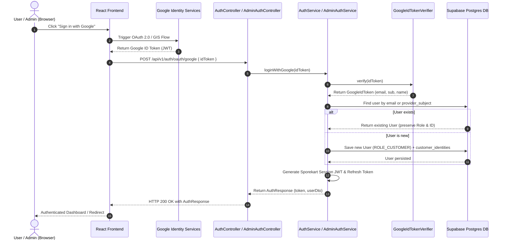

# Sporekart Google-Only Authentication Architecture

## 1. Architectural Summary & Scope

This document details the single-tenant authentication architecture for Sporekart. The system relies strictly on **Google OAuth 2.0 / OpenID Connect** as the single identity authentication provider for both Customer and Admin access.

All legacy authentication mechanisms—including Email + Password, Phone Number, Email OTP, and Phone/SMS OTP—have been completely retired.

### Core Architectural Principles
1. **Google OAuth 2.0 as Single Identity Provider (IdP)**: All user authentication flow starts with valid Google ID tokens issued by Google's OAuth servers.
2. **Backward-Compatible RBAC & Identity Mapping**:
   - Existing user accounts are preserved.
   - Primary lookup matches the verified email provided in the Google ID Token against existing `users.email`.
   - Provider subjects are persisted in `customer_identities` (`provider = 'GOOGLE'`, `provider_subject = sub`).
   - If an existing user matches by email, their existing role (`ROLE_ADMIN`, `ROLE_CUSTOMER`, `ROLE_TRAINEE`) is preserved.
   - If no existing user matches, a new user account is provisioned with default `ROLE_CUSTOMER`.
3. **HTTP 410 GONE Endpoint Retirement**:
   - Legacy endpoints (`/api/v1/auth/otp/request`, `/api/v1/auth/otp/verify`, `/api/v1/admin/auth/otp/request`, `/api/v1/admin/auth/otp/verify`) return explicit `HTTP 410 GONE` error responses with detailed error payloads informing clients that OTP authentication is permanently retired.
4. **Preserved Schema Integrity**:
   - The database schema (`users`, `customer_identities`, `otps`) remains intact.
   - No table columns are dropped, preserving database migration compatibility and existing foreign keys.
5. **Preserved Transactional SMTP Email Services**:
   - Business transactional email notifications (order confirmation, payment receipts, shipping tracking, training enrollment) remain fully operational via JavaMailSender/SMTP.
   - Unused OTP email sending methods have been stripped from `NotificationService`.

---

## 2. Authentication Flow

---

## 3. Endpoints Status Matrix

| Endpoint | Method | Status | Behavior / Response |
| :--- | :--- | :--- | :--- |
| `/api/v1/auth/oauth/google` | `POST` | **Active** | Accepts `{ idToken }`, verifies Google JWT, authenticates/provisions user, returns session JWT. |
| `/api/v1/auth/me` | `GET` | **Active** | Returns currently authenticated user details & active role. |
| `/api/v1/auth/otp/request` | `POST` | **Retired** | Returns `HTTP 410 GONE`: *"OTP authentication has been retired. Please sign in using Google Auth."* |
| `/api/v1/auth/otp/verify` | `POST` | **Retired** | Returns `HTTP 410 GONE`: *"OTP authentication has been retired. Please sign in using Google Auth."* |
| `/api/v1/admin/auth/otp/request` | `POST` | **Retired** | Returns `HTTP 410 GONE`: *"Admin OTP login has been retired. Please sign in using Google Auth."* |
| `/api/v1/admin/auth/otp/verify` | `POST` | **Retired** | Returns `HTTP 410 GONE`: *"Admin OTP login has been retired. Please sign in using Google Auth."* |

---

## 4. Role-Based Access Control (RBAC) Mapping

- **ROLE_ADMIN**: Retained for existing administrator accounts. Attempting Google login with an email matching an existing admin account grants full `ROLE_ADMIN` permissions.
- **ROLE_CUSTOMER**: Assigned to all newly provisioned accounts signing in via Google Auth.
- **ROLE_TRAINEE**: Retained for users enrolled in training programs.
